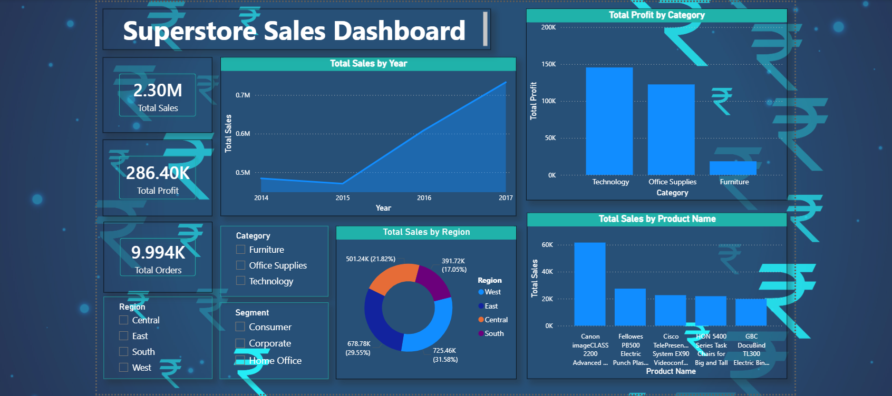

# 🛒 Sales Data Analysis & Dashboard Project  

📊 **End-to-End Data Analysis** of retail sales data using **Python, Excel & PowerBI**.  
This project demonstrates skills in **data cleaning, exploratory analysis, visualization, and reporting**.  

Dataset: [📂 Kaggle – Superstore Sales](https://www.kaggle.com/datasets/vivek468/superstore-dataset-final)  

---

## 🚀 Tech Stack  

 
 
 
 
  

---

## 🔹 Project Goals  
✔️ Clean raw sales data (10,000+ records)  
✔️ Explore **monthly sales trends**  
✔️ Identify **top products** and categories  
✔️ Compare **regional sales performance**  
✔️ Build an **interactive dashboard in PowerBI**  

---

## 📊 Key Insights  
- 📈 Sales show an upward trend during festive months (November–December)  
- 🛍️ **Chairs** and **Phones** were among the highest revenue generators  
- 🌍 The **West region** contributed the most to overall sales  
- 📉 Some categories had low profit margins despite high sales  

---

## Power BI Dashboard

This dashboard extends the Python and Excel analysis in this repository
using the same Superstore dataset. It provides an interactive view of
sales performance through KPI cards, charts, and slicers.

### Dashboard Features

- KPI cards for total sales, total profit, and order count.
- Monthly sales trends.
- Regional sales comparisons.
- Product-performance comparisons.
- Interactive filters for category, region, and customer segment.

### Dashboard Preview



### Power BI File

[Download the Power BI report](PowerBI/Superstore_Sales_Dashboard.pbix)

Open the `.pbix` file in Power BI Desktop to explore the report.

### Project Workflow

1. Explore and prepare the Superstore data using Python and Excel.
2. Analyze product, regional, and seasonal sales patterns.
3. Present performance metrics through an interactive Power BI dashboard.

---

## ⚙️ How to Run  

1. Clone the repository  
   ```bash
   git clone https://github.com/adiratna89/sales-data-analysis.git
   ```

2. Install dependencies  
   ```bash
   pip install pandas matplotlib seaborn
   ```

3. Open and run the Jupyter Notebook:  
   ```
   analysis.ipynb
   ```

---

## 📌 Sample Visualizations  

<a href="https://github.com/adiratna89/sales-data-analysis/blob/main/Extra%20resources%20-%20Resume%20and%20Screenshots/Screenshot%202025-09-24%20184249.png">
  </a>   <a href="https://github.com/adiratna89/sales-data-analysis/blob/main/Extra%20resources%20-%20Resume%20and%20Screenshots/Screenshot%202025-09-24%20184558.png"></a>   <a href="https://github.com/adiratna89/sales-data-analysis/blob/main/Extra%20resources%20-%20Resume%20and%20Screenshots/Screenshot%202025-09-24%20184632.png"></a>


- Monthly Sales Trend
- Top 10 Products by Sales  
- Regional Sales Performance  

---

## 📂 Project Structure  

```
Sales-Data-Analysis/
|── PowerBI/
      |── Superstore_Sales_Dashboard.pbix   # PowerBI Dashboard
      |── dashboard-preview.png             # Preview of Dashboard
│── analysis.ipynb   # Jupyter Notebook with Python analysis
│── Superstore.csv   # Dataset
│── README.md        # Project documentation
```

---

## 📄 Resume  

You can directly download my latest **Data Analyst Resume** here:  

- [📑 Resume (PDF Version)](https://github.com/adiratna89/sales-data-analysis/blob/main/Extra%20resources%20-%20Resume%20and%20Screenshots/Adiratna_Kamble_Data_Analyst_Resume.pdf)  
- [📑 Resume (Word Version)](https://github.com/adiratna89/sales-data-analysis/blob/main/Extra%20resources%20-%20Resume%20and%20Screenshots/Adiratna_Kamble_Data_Analyst_Resume.docx)  

---

## 👤 Author  

**Adiratna Kamble**  
- 📧 
- (mailto:adi8976839010@gmail.com)  
- 🔗 
- (www.linkedin.com/in/adiratna-kamble)  
- 💻 
- (https://github.com/adiratna89)  
- 📱 Phone: +91 77180 80580 / 89768 39010  

---
✨ *“Turning raw data into business insights through analytics and visualization.”*  
